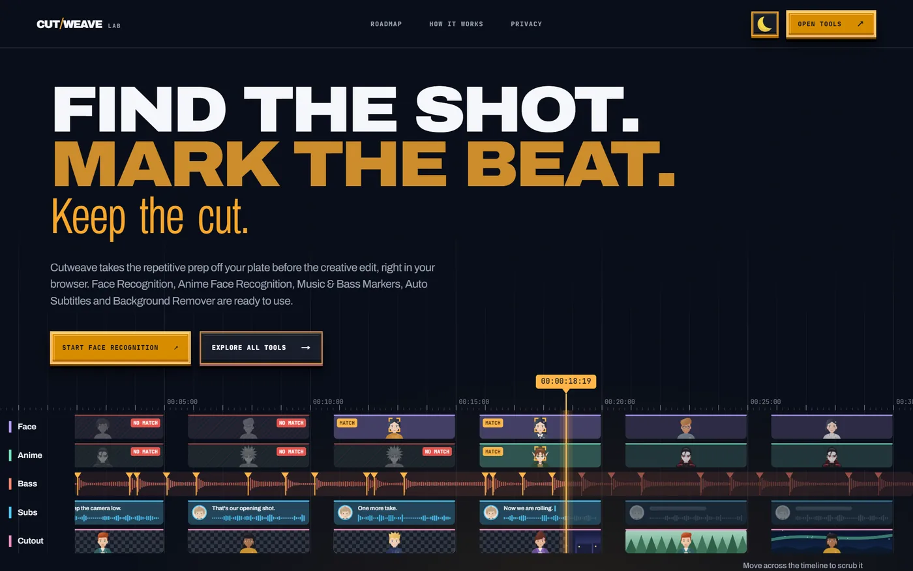
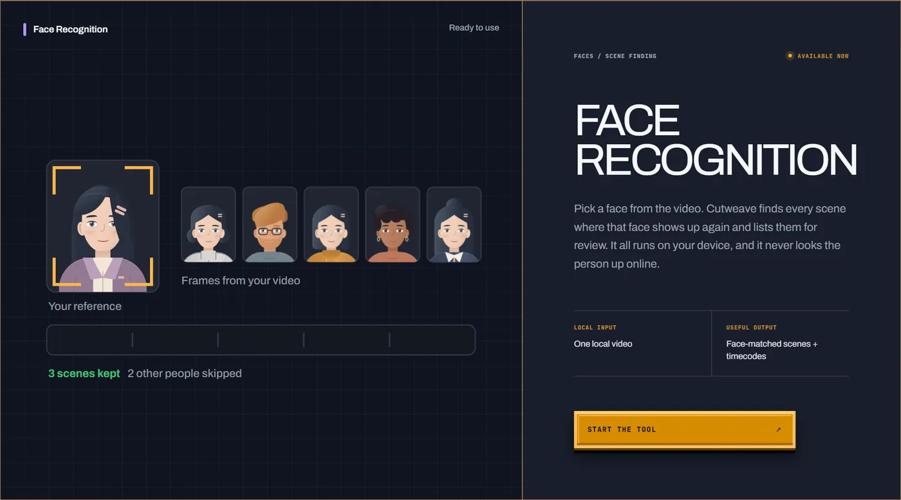
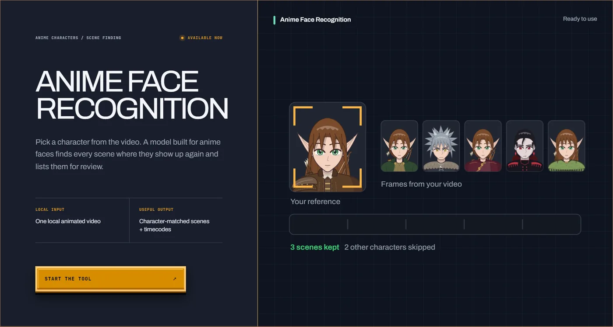
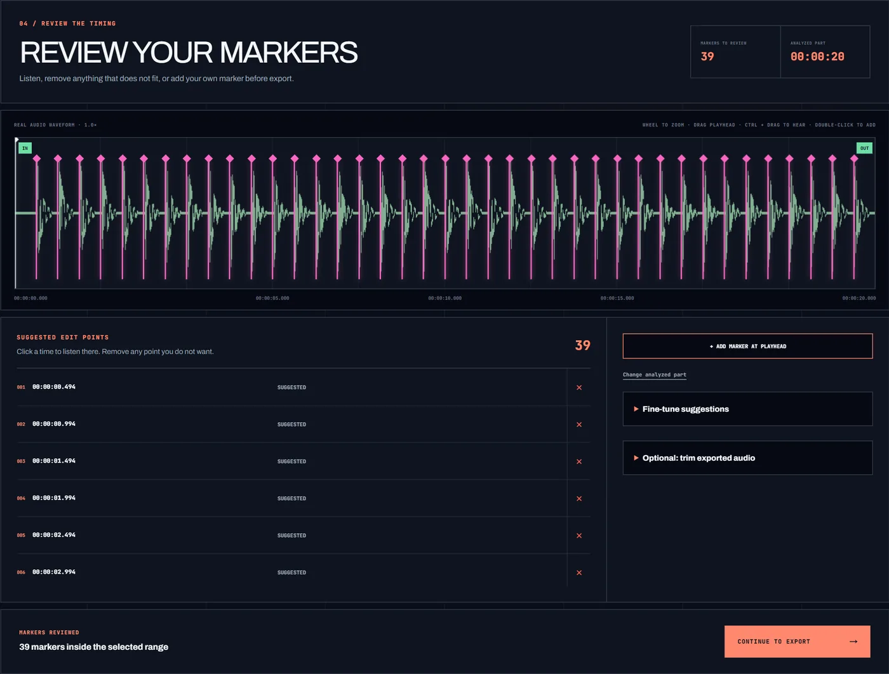
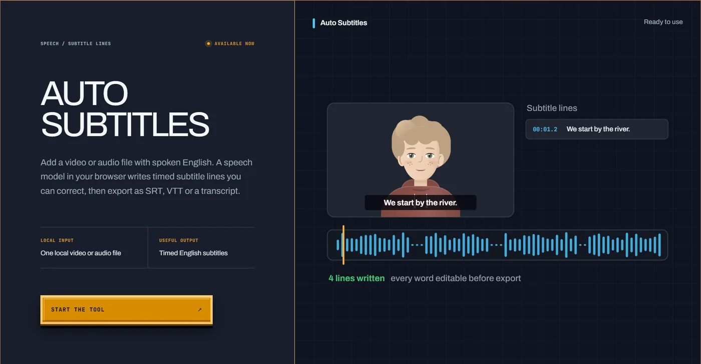
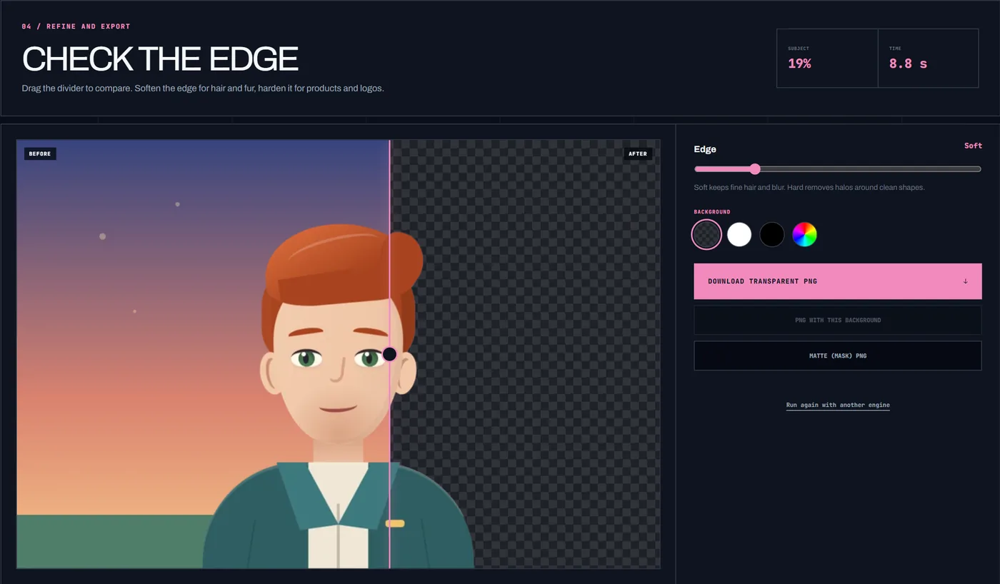
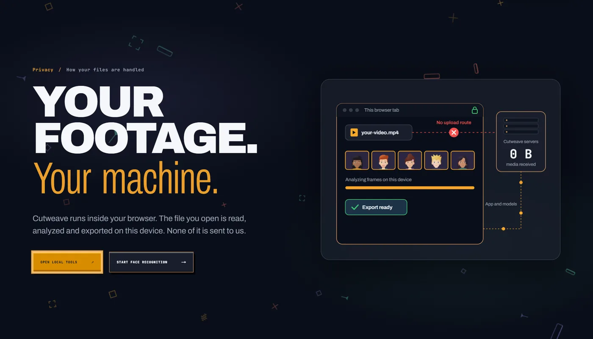
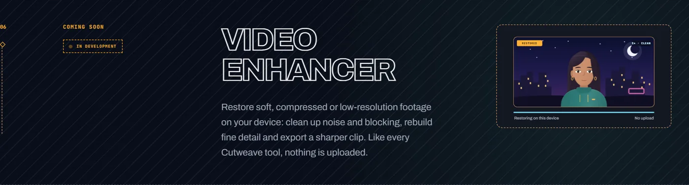

<p align="center">
  
</p>

<h1 align="center">CUT/WEAVE LAB</h1>

<p align="center">
  <b>Find the shot. Mark the beat. Keep the cut.</b><br>
  Five small tools for the repetitive prep before a creative edit, running entirely in your browser.
</p>

<p align="center">
  <a href="https://cutweave-lab.vercel.app"><b>Open the live app</b></a> ·
  <a href="#automated-testing-with-testsprite">See how we test it</a> ·
  <a href="docs/PRIVACY.md">Read the privacy boundary</a>
</p>

<p align="center">
  No account. No upload. Your footage, songs and images never leave your device.
</p>

<p align="center">
  
</p>

---

## A day in the edit

Editors lose hours to jobs that are not editing: scrubbing for one face, tapping out beats, typing subtitles, masking a thumbnail. Cutweave gives each of those jobs its own focused screen. You open a local file, the browser does the work on your device, and you review every result before anything is exported.

### 00:00:09 · Find the face

<p align="center">
  
</p>

Pick three moments where the person you need is clearly visible and crop their face. Cutweave scans the whole video for that face and lists every matching scene with its timecodes. Keep or drop each scene, then download the clips as an MP4 ZIP. It is a similarity search inside the one video you opened: it never names anyone and never looks a person up.

### 00:01:30 · Find the character

<p align="center">
  
</p>

Drawn faces break ordinary face models, so anime gets its own workspace with a detector and a character encoder built for animation. The flow is the same: three references, one scan, scenes to review, clips to keep.

### 00:03:00 · Mark the beat

<p align="center">
  
</p>

Drop in a song. Cutweave finds the hits and bass drops worth cutting to and places them on the real waveform. Move, remove or add markers, pick your composition frame rate, and download an **MP3 or WAV with markers** that Premiere Pro and After Effects read on import, or an XMP, JSON or CSV file. Above: the synthetic 120 BPM test track, with a marker on every kick, half a second apart.

### 00:05:00 · Write the subtitles

<p align="center">
  
</p>

Spoken English becomes timed subtitle lines inside the tab. Fix any word by hand, then export SRT for Premiere Pro, DaVinci Resolve and Final Cut Pro, an After Effects script, WebVTT or a plain transcript.

### 00:07:00 · Cut out the subject

<p align="center">
  
</p>

Drop a photo, still or illustration. The subject is lifted off the background on your device, on the GPU when your browser supports it and on the CPU everywhere else. Soften or harden the edge, preview it on any colour, and export a transparent PNG, a PNG on your background or a matte.

### After the edit · Nothing left the room

<p align="center">
  
</p>

There is no upload route, storage bucket, account or database. The browser downloads the app and its models; your media takes no part in that traffic. The privacy page shows exactly what moves and what never does.

### Next on the roadmap

<p align="center">
  
</p>

A Video Enhancer that restores soft, compressed footage on your device is in development. It is marked as coming soon and is not offered as a tool yet.

---

## Tools

| Tool | Route | You add | You get |
|---|---|---|---|
| Face Recognition | [`/lab/face-recognition`](https://cutweave-lab.vercel.app/lab/face-recognition) | One local video and three reference frames you crop yourself | Matched scenes with timecodes you can review, then an MP4 clip ZIP (WebM fallback where needed) |
| Anime Face Recognition | [`/lab/anime-face-recognition`](https://cutweave-lab.vercel.app/lab/anime-face-recognition) | One local animated video and three character references | Character-matched scenes and a clip ZIP, using an anime-specific local model |
| Music & Bass Markers | [`/lab/bass-markers`](https://cutweave-lab.vercel.app/lab/bass-markers) | One local audio file | Adjustable impact and bass markers on a real waveform, exported as an MP3 or WAV with markers for Premiere Pro and After Effects, an XMP sidecar, JSON or CSV |
| Auto Subtitles | [`/lab/auto-subtitles`](https://cutweave-lab.vercel.app/lab/auto-subtitles) | One local video or audio file with spoken English, whole or a chosen part | Word-timed subtitle lines you can correct, exported as SRT (Premiere Pro, DaVinci Resolve, Final Cut Pro), an After Effects script, WebVTT or a plain transcript |
| Background Remover | [`/lab/background-remover`](https://cutweave-lab.vercel.app/lab/background-remover) | One local PNG, JPEG or WebP image | The subject cut out with an adjustable edge, exported as a transparent PNG, a PNG on a background colour you pick, or a matte PNG |

Other pages: the tool library ([`/lab`](https://cutweave-lab.vercel.app/lab)), the privacy boundary ([`/privacy`](https://cutweave-lab.vercel.app/privacy)) and the roadmap ([`/roadmap`](https://cutweave-lab.vercel.app/roadmap)).

## Privacy by architecture

- The app has no media upload route, storage bucket, account or database.
- A selected file opens as a browser object URL. Frames, waveforms, crops and face descriptors are created and used only inside the tab, in dedicated Web Workers.
- Face Recognition is a similarity search within the one video you opened. It never identifies a person and never queries an external database.
- The browser downloads only application code, WASM runtimes and model files. They come from this site, except the English speech model for Auto Subtitles (`onnx-community/whisper-base.en_timestamped`) and the background models for Background Remover (BiRefNet lite on GPU, ormbg on CPU), which are downloaded once from Hugging Face at pinned revisions and cached by the browser. Those requests never contain your media.

Details: [`docs/PRIVACY.md`](docs/PRIVACY.md).

## Automated testing with TestSprite

The live app is tested with [TestSprite](https://www.testsprite.com). The TestSprite GitHub App runs the suite automatically against each pull request's Vercel preview deployment and reports the result on the PR. `main` is protected: a pull request can only be merged once the required **TestSprite V3** check passes, and force pushes to `main` are blocked.

**Live URL under test:** https://cutweave-lab.vercel.app

| Pull request | What it added | TestSprite result |
|---|---|---|
| [#4](https://github.com/raevor/Cutweave-Lab/pull/4) | The TestSprite suite with real tool flows, opened on October 21 inside the October 16–22 window | 65/65 |
| [#5](https://github.com/raevor/Cutweave-Lab/pull/5) | Auto Subtitles | 72/72 |
| [#6](https://github.com/raevor/Cutweave-Lab/pull/6) | Background Remover, MP3 markers, the Cutout lane | 84/85 → 84/85 → 85/85 |
| [#7](https://github.com/raevor/Cutweave-Lab/pull/7) | CPU background removal fix, deeper flow tests | 92/92 |

The current TestSprite plan has 92 browser tests in fourteen groups. Besides page structure, it drives real tool flows with files: the runner loads a video into Face Recognition and adds one reference, takes audio markers from analysis to the export step and checks their timing, and completes a CPU background removal with a test image.

| Area | Tests | What they check |
|---|---:|---|
| Navigation & shell | 15 | Brand and hero, the header tools menu (open, launch each of the five tools, close with Escape or an outside click, open the tool desk), theme switch, its accessible name and persistence after reload, the How it works, Roadmap and Privacy links, and the right-edge section timeline |
| Home page | 11 | The three hero lines and both calls to action, all four facts, the four workflow steps, five tool cards in order with working routes, illustration captions, footer links and Back to top, and the media boundary section |
| Tool library | 9 | Exactly five tools on tracks 01 to 05 with input and output details, each Start tool link, the heading, the tool desk summary and the privacy link |
| Face Recognition | 7 | Empty source state, the five-step bar, privacy copy, 0 B sent to server, no scan action or results before a video is chosen, the All tools and Privacy links |
| Face Recognition video flow | 2 | Loading a video into the workspace, reaching the references step and adding one face reference through the crop dialog |
| Anime Face Recognition | 5 | The first-visit notice (dismiss, keep hidden after reload, reopen from the header), the empty source state, 0 B sent to server and the All tools link |
| Music & Bass Markers | 4 | Empty state, the five-step bar, 0 B sent to server, no analysis or export before a file is loaded, accepted formats and the privacy link |
| Music & Bass Markers audio flow | 9 | Loading audio, finding markers on the full track, adding and removing a marker, checking marker times on the synthetic 120 BPM track, the MP3, WAV and text export options, the composition frame-rate selector, returning to review and cancelling an analysis |
| Auto Subtitles | 5 | Empty source state, the five-step bar, 0 B sent to server, English speech and SRT/VTT output, no transcription or export before a file is chosen, the All tools and Privacy links |
| Background Remover | 5 | Empty source state, the five-step bar, 0 B sent to server, input and output facts, no removal or export before an image is chosen, the All tools and Privacy links |
| Background Remover image flow | 6 | Loading an image with its size and dimensions, choosing the CPU engine, starting and cancelling a removal, removing the source, completing a CPU removal with comparison and export controls, and choosing a background colour to enable its PNG export |
| Privacy | 7 | Local processing and 0 B media transfer, no identity lookup or biometric database query, what the browser downloads versus what never leaves the tab, the model credits, the summary values and both calls to action |
| Roadmap | 3 | Exactly five shipped tools, Video Enhancer shown only as coming soon, and the link to the tool library |
| Not found | 4 | The custom 404 page for unknown tool and top-level routes, its label and the way back home |

<details>
<summary><b>What the cloud suite does not cover, and why</b></summary>

The flow tests use three files prepared only for this suite: a synthetic 120 BPM click track, a short test video clip and a test image. They are stored in the TestSprite project and are not part of this repository. Earlier video flow tests were removed after the runner repeatedly treated file selection as a forbidden upload. The current plan includes video loading and one face reference. A newly attempted full Face Recognition scan was removed after the runner could not seek to the three requested reference times and left the reference count at 0/3; it did not reach the scan. Full face and anime scans, match quality and clip exports remain local manual checks, supported by unit tests of matching and scene selection. Music marker timing is checked against the known kicks in the synthetic track. Auto Subtitles is tested in the cloud only up to its empty state: a transcription first downloads an 80 to 210 MB speech model, so its flow (full source, a chosen part, cancel, editing and every export) is checked locally, against the Tears of Steel open movie (CC BY 3.0, Blender Foundation) and a synthetic speech clip, and its decoding rules are covered by unit tests. The Background Remover tests complete a CPU run with the pinned ormbg model (about 45 MB on first use), check the comparison and export controls, and select a background colour; GPU quality, edge adjustments and the downloaded PNG files are checked locally. Cloud tests stop at export controls and do not download or validate the exported files. The responsive layout is also checked locally: the cloud runner cannot resize its viewport, so a 390px mobile test was removed from the plan after it came back blocked.

On PR #6 the first run passed 84 of 85. The one blocked test, the Music & Bass Markers export step, never attached its audio file: the runner read the PRD's privacy wording as a ban on uploads, while four other tests in the same run attached the same file and passed. The PRD then stated that attaching a test file in the browser is required and is not an upload, and that test spelled out the same. The second run fixed it but blocked a different image test for the same reason, again 84 of 85. A direct runner instruction was added to the PRD and the file-attaching tests; the third run passed 85 of 85. The current PRD also explicitly excludes the removed three-reference face scan from cloud scope.

While writing the deeper flow tests for PR #7, a full CPU background removal crashed with `std::bad_alloc`: BiRefNet lite at 1024 × 1024 needs more than WebAssembly's 4 GB. The CPU engine was moved to the lighter ormbg model before the tests were added, and the new tests now run that path in the cloud.

</details>

The published source includes 134 unit tests in 17 files for matching, scene selection, marker analysis and export formats, subtitle processing and matte refinement.

Local checks:

```bash
npm run typecheck   # Next.js type generation + TypeScript
npm run lint
npm test            # Vitest unit tests: face matching, clip export, marker analysis, MP3/WAV export, subtitles, matte refinement
npm run build
```

## Run locally

```bash
npm install
npm run dev
```

Open http://localhost:3000. Chrome or Edge is recommended. Face and anime analysis use WebGPU when available and fall back to WebAssembly.

## Stack

Next.js (App Router), React and strict TypeScript; Tailwind CSS v4 with OKLCH design tokens; @vladmandic/face-api, ONNX Runtime Web and Transformers.js for on-device models; Mediabunny and WebCodecs for local decoding and export; Vitest for unit tests.

See [`docs/ARCHITECTURE.md`](docs/ARCHITECTURE.md) and [`docs/DESIGN.md`](docs/DESIGN.md). The illustrated cast is original and drawn in code; every screenshot above was taken from the app with the project's own test files and characters.
